# ProbC results: `results/synthetic`

> These numbers come from `python -m probc run all --synthetic`, i.e. from genomes simulated from the ProbC model (4 chromosomes x 1,500 sites, the paper's 32 marks, planted signal on H3K27ac, H3K9me3, H3K4me3, H3K4me1 and CTCF). They check that every analysis runs and behaves sensibly; they are not estimates of the paper's real-data results.

Run time per experiment (s): mark_selection 57.7, heatmaps 51.6, prediction 39.0, domains 3.9, perturbation 13.5, transfer 76.2, robustness 207.8, stability 5.9

## Mark selection (Fig. 1, diagonal-only ranking, coverage)

Top marks with interactions between different marks forbidden: **H3K4me1, H3K9me3, CTCF, H3K27ac, H3K4me3**

| n_marks | histone modifications | TFBS (+DNase) |
|---|---|---|
| 1 | 0.603 | 0.576 |
| 2 | 0.697 | 0.604 |
| 3 | 0.760 | 0.614 |
| 4 | 0.808 | 0.620 |
| 5 | 0.810 | 0.619 |
| 6 | 0.822 | 0.626 |
| 7 | 0.831 | 0.618 |
| 8 | 0.835 | 0.619 |
| 9 | 0.842 | 0.627 |
| 10 | 0.840 | 0.628 |
| 11 | 0.841 | 0.630 |
| 12 | 0.843 | 0.631 |
| 13 | 0.845 | 0.632 |
| 14 | 0.845 | 0.632 |
| 15 | 0.846 | 0.632 |
| 16 | 0.846 | 0.632 |

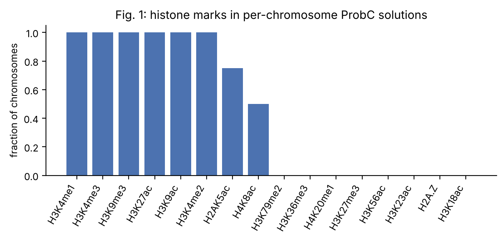

*Fig. 1 analogue: frequency of histone marks in per-chromosome solutions*

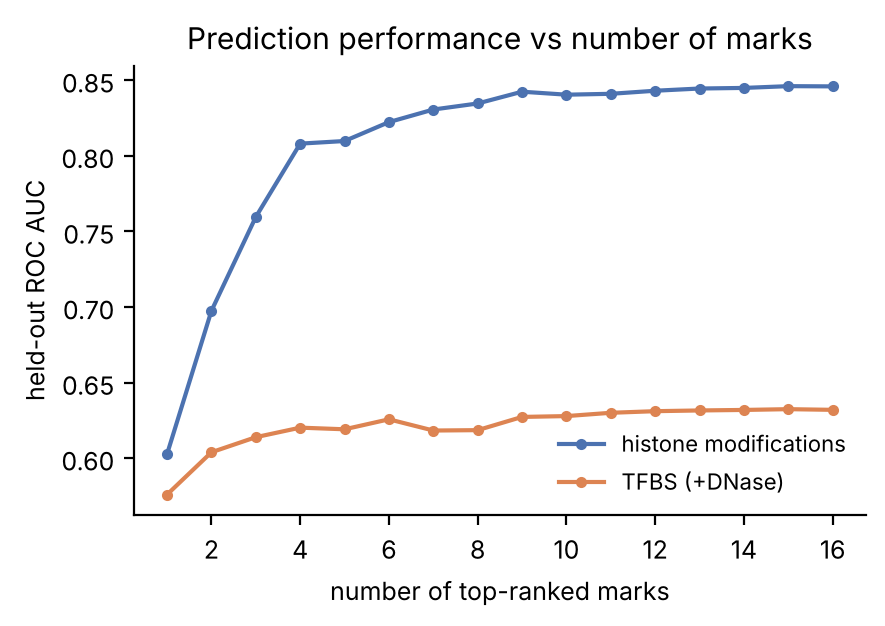

*Held-out AUC vs number of top-ranked marks*

## Interaction probabilities (Figs. 2-3, Table 2)

Pearson correlation of histone interaction matrices between cell types: **0.966** (Spearman 0.265).

Correlation with planted parameters (histone-only model): 0.972

| interaction | hESC | IMR90 | abs_diff |
|---|---|---|---|
| H3K4me1 - H3K4me1 | 0.118 | 0.090 | 0.028 |
| H3K27me3 - H3K27me3 | 0.021 | 0.039 | 0.018 |
| H3K4me1 - H2A.Z | 0.001 | 0.017 | 0.016 |
| H3K4me1 - H4K8ac | 0.016 | 0.003 | 0.014 |
| H3K4me1 - H2AK5ac | 0.016 | 0.003 | 0.013 |

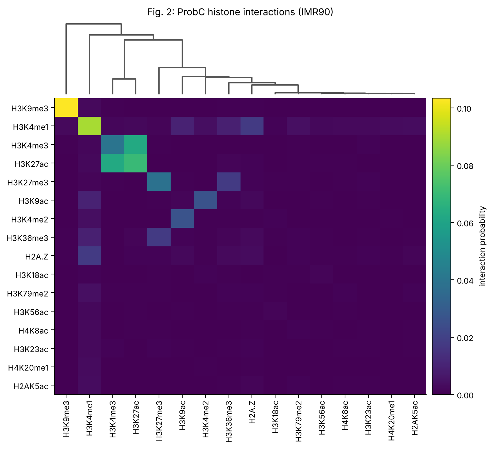

*fig2 histone interactions IMR90*

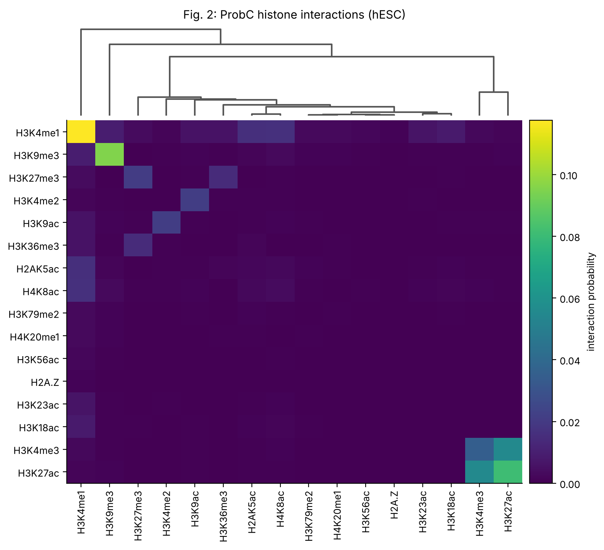

*fig2 histone interactions hESC*

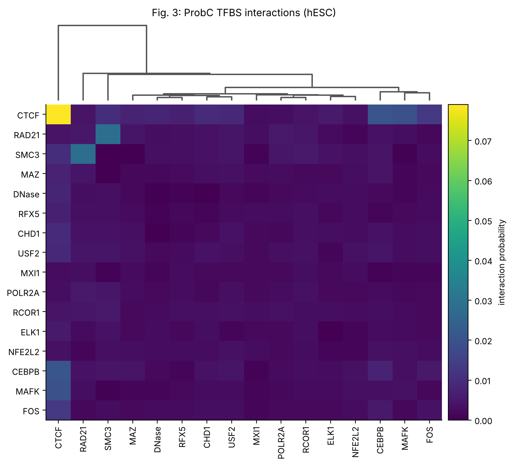

*fig3 tfbs interactions hESC*

## Interaction prediction (Figs. 4-8)

Marks: H3K27ac, H3K9me3, H3K4me3, H3K4me1, CTCF. Fig. 4 mean AUC: within-chromosome 0.793, cross-chromosome 0.791.

| chrom | ProbC | HiC-Reg (RF) | distance decay b=1.0 | distance decay b=1.5 | distance decay b=2.0 |
|---|---|---|---|---|---|
| chr1 | 0.804 | 0.783 | 0.540 | 0.540 | 0.540 |
| chr2 | 0.776 | 0.759 | 0.528 | 0.528 | 0.528 |
| chr3 | 0.798 | 0.776 | 0.553 | 0.553 | 0.553 |
| chr4 | 0.796 | 0.773 | 0.555 | 0.555 | 0.555 |

Fig. 6 (chr1): SCC = 0.945, Spearman = 0.797

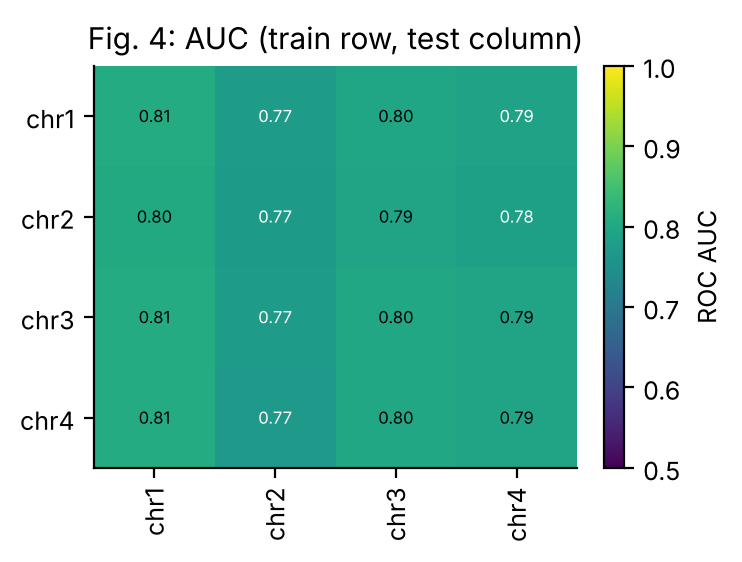

*Fig. 4 analogue*

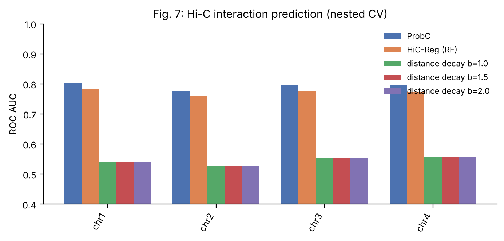

*Fig. 7 analogue*

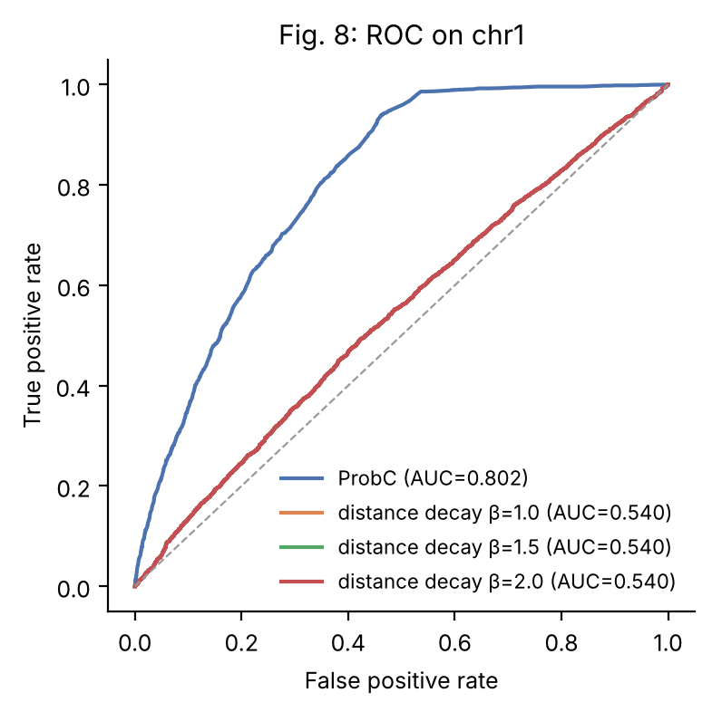

*fig8 roc distance decay chr1*

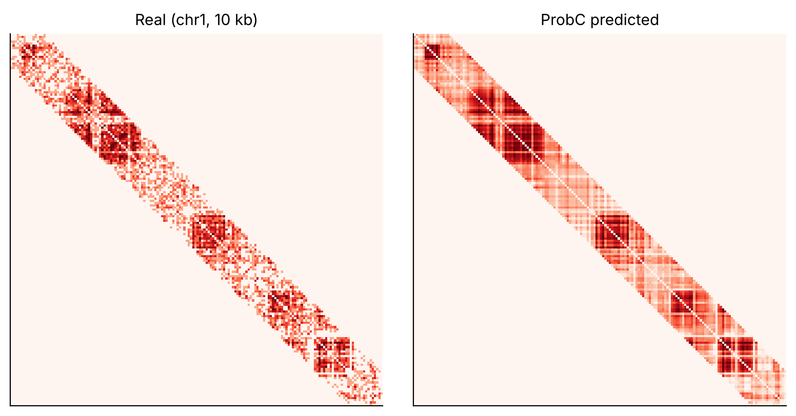

*fig6 matrix chr1*

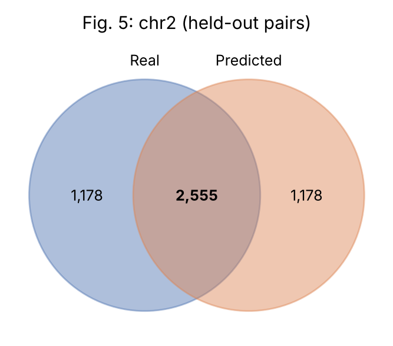

*fig5 venn chr2*

## Domains (Fig. 9, Table 3)

| kind | resolution | histone | histone+tfbs | tfbs |
|---|---|---|---|---|
| TAD | 5000 | 0.072 | 0.061 | 0.098 |
| TAD | 20000 | 0.046 | 0.033 | 0.070 |
| compartment | 10000 | 0.062 | 0.069 | 0.089 |

| metric / resolution (bp) | 2000 | 5000 | 10000 | 20000 |
|---|---|---|---|---|
| True Positives | 127 | 89 | 65 | 53 |
| True Positive Rate | 0.263 | 0.31 | 0.455 | 0.726 |
| False Negatives | 356 | 198 | 78 | 20 |
| False Negative Rate | 0.737 | 0.69 | 0.545 | 0.274 |
| False Positives | 246 | 45 | 18 | 8 |
| Predicted TAD Boundaries | 373 | 134 | 83 | 61 |
| True TAD Boundaries | 483 | 287 | 143 | 73 |

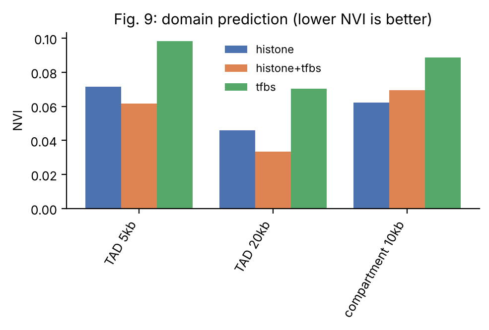

*Fig. 9 analogue (NVI, lower is better)*

## Perturbations

**ctcf_masking**

| variant | n_tads | separate_tads | anchor_contact |
|---|---|---|---|
| unperturbed | 2 | True | 4.861 |
| boundary CTCF masked | 2 | True | 4.861 |
| all CTCF between masked | 2 | True | 4.000 |

**deletion**

| variant | n_tads | separate_tads | DS1_DS3_contact |
|---|---|---|---|
| wild type | 2 | True | 0.789 |
| deletion | 2 | True | 0.789 |

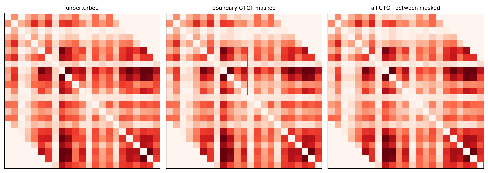

*Predicted maps after CTCF masking*

## Cross-species / cross-cell-type (Figs. 10-11)

| experiment | mean AUC |
|---|---|
| fig10a_human_from_mouse | 0.786 |
| fig10b_mouse_from_human | 0.796 |
| fig11_hESC_from_IMR90 | 0.787 |
| fig11b_IMR90_from_hESC | 0.776 |

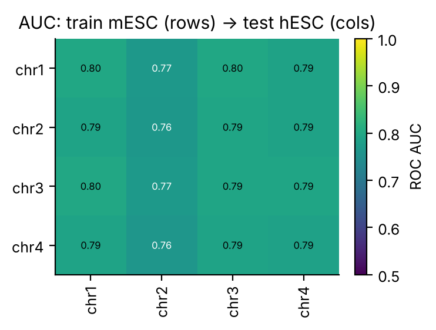

*Fig. 10a analogue*

## Robustness (Fig. 12)

**lambda_l1**

| lambda_l1 | auc | active_marks | effective_rank |
|---|---|---|---|
| 0.000 | 0.920 | 12 | 11 |
| 0.000 | 0.920 | 12 | 11 |
| 0.001 | 0.920 | 12 | 11 |
| 0.010 | 0.920 | 10 | 12 |
| 0.030 | 0.919 | 7 | 12 |
| 0.100 | 0.919 | 7 | 12 |

**lambda_nuc**

| lambda_nuc | auc | active_marks | effective_rank |
|---|---|---|---|
| 0.000 | 0.920 | 12 | 12 |
| 0.000 | 0.920 | 12 | 12 |
| 0.001 | 0.920 | 12 | 11 |
| 0.010 | 0.920 | 10 | 8 |
| 0.030 | 0.918 | 8 | 8 |
| 0.100 | 0.889 | 12 | 2 |

## Stability (Fig. 13)

Enzyme replicates, Spearman per chromosome: chr1 0.370, chr2 0.363, chr3 0.448, chr4 0.516

Enzyme replicates, Pearson per chromosome: chr1 0.894, chr2 0.945, chr3 0.957, chr4 0.895

Resolutions, mean Pearson: 10kb-40kb 0.580, 2kb-10kb 0.917, 2kb-40kb 0.659

Resolutions, mean Spearman: 10kb-40kb 0.479, 2kb-10kb 0.475, 2kb-40kb 0.386

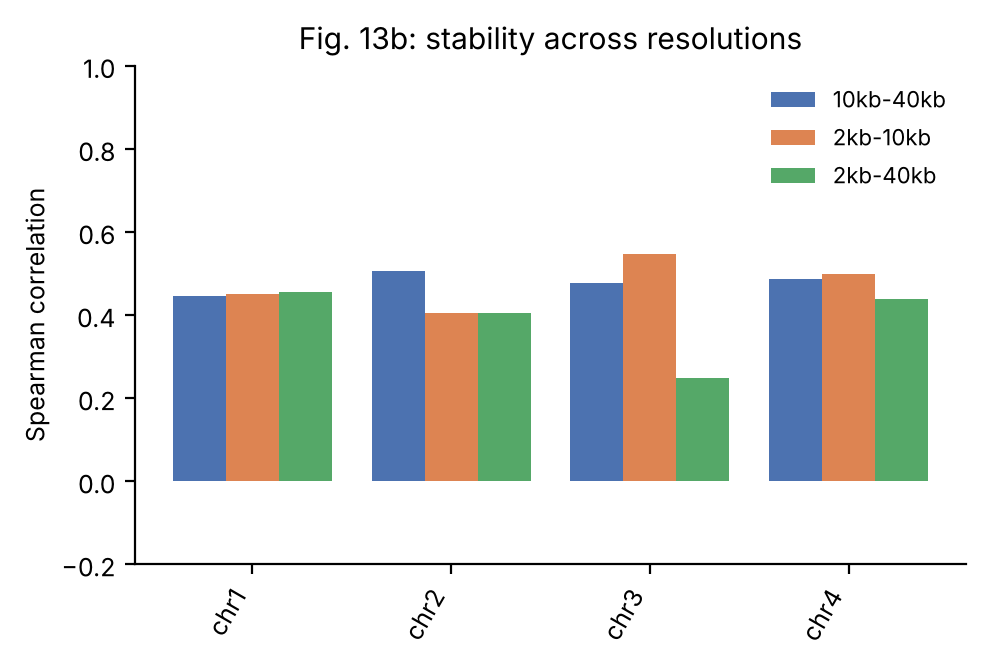

*Fig. 13b analogue*
